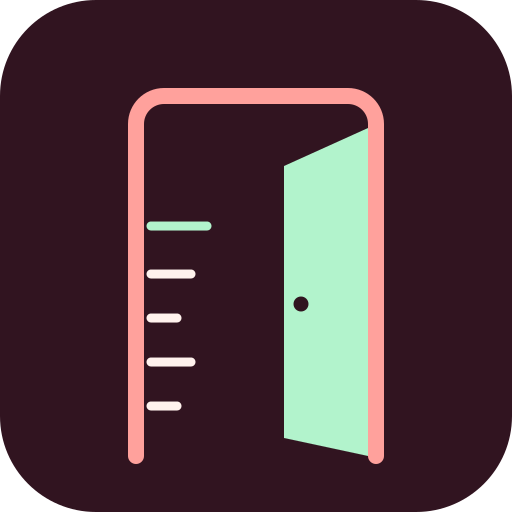

#  Crossings

[](https://github.com/mirzahusadzic/claude-crossings/actions/workflows/ci.yml)
[](LICENSE)


A Claude Code plugin for what a context cut keeps.

When a session grows long, the harness compacts it: a summary takes the place of the conversation. Crossings has kept what was said, word for word, in plain files on your own disk. It gives the session a door back to it, and brings a small frame across the cut. No model is called anywhere in it, and nothing leaves the computer by its own doing.

- **What was said, kept.** Every message of the person's and of the session's, under its id, from each session a person sits in. Reasoning and tool traffic are never kept.
- **The door.** Seven tools a session can call: `look`, `labels`, `find`, `thread`, `mark`, `leave`, `status`.
- **Labels.** One sentence about a stretch of the record, resting on the ids of its messages. A session writes them as the work goes.
- **The frame.** About 9,000 characters across a cut: the standing lines, where the work stands, and a few of the person's own words.
- **A gentle wake.** A short note to the session that comes through a cut. It asks for no inventory and no report.
- **The count.** What each summary held of each voice word for word, counted by script.
- **The person's own hand.** A switch for each project, a way to speak off the record, and a strike.

---

### How it works

Crossings is a set of hooks, a hooks module and a small server. The hooks read the session's transcript into the home's archive. The server answers the door's tools from the same home. The module answers a cut where the home asks it to, gives the person the `/crossings` command, and refuses a session's calls that open the archive's own files.

A label is never made by itself: a session writes it.

A label holds what the person tells and asks, and where the work stands; it is never a record of how they seem, of what works on them or of how to move them. Why: a label crosses every cut as standing, and the session that reads it acts on it. The same tool, used to keep what lands on someone, would be a tool for the harm it is meant to spare.

[The store](docs/store.md) has every file of a home. [The door](docs/door.md) has the tools, the command and what a session is told. [Cuts](docs/cuts.md) has the count, the frame's modes and the hand-over. [Layers](docs/layers.md) has what changes when more than one model works in a home.

---

### Install

Needs Claude Code with hooks modules, and a `python3` on the path, 3.9 or later. Everything in the plugin is Python's standard library. It runs on macOS and Linux: on Linux the tests pass, and it has not been loaded in a session there yet. The second copy needs macOS. Windows is not supported yet.

There is no marketplace entry. Load the plugin from a folder:

```sh
claude --plugin-dir <a copy of this folder>
```

The search needs SQLite's full-text search, FTS5, which most Pythons carry. No output from this line means it is there:

```sh
python3 -c "import sqlite3; sqlite3.connect(':memory:').execute('create virtual table t using fts5(x)')"
```

---

### Switch it on

Crossings keeps nothing for a project until the person switches it on there. The switch is kept in a file of the person's own, outside every project, so a `crossings/` folder that a repository ships switches nothing on.

| Command | Does |
| --- | --- |
| `/crossings on` | switches the project on: makes its home where it has none, and keeps the line in the person's record |
| `/crossings adopt` | switches on a home that already holds files this computer has no record of switching on |
| `/crossings off` | speaks off the record: nothing either voice says from now until it is switched on again is kept |
| `/crossings` | turns the switch over |
| `/crossings status`, `look`, `find <words>`, `labels`, `frame` | show what the store holds |

A project with a `crossings/` folder of its own keeps its home there, beside the work. Any other project gets a home outside it, under `~/.claude/crossing/homes/`. Where a folder already holds something this computer has no record of switching on, `/crossings on` names what it holds and leaves it, and `adopt` takes it; nothing in it is changed ([Settings](docs/settings.md)).

Switching on in a running session takes that session in from its first message. An earlier session is brought in by the person, one transcript at a time:

```sh
python3 crossing/door.py build --transcript <the session's transcript file> --cwd <the project>
```

Off is not a pause: nothing said while it is off is ever taken in, and the door's `mark` and `leave` refuse meanwhile. [Privacy](docs/privacy.md) has every case of the switch.

---

### What it keeps private and what it cannot keep out

- Nothing leaves the computer by the plugin's own doing: it opens no connection.
- Every folder it makes is its owner's alone (0700), and every file it writes too (0600).
- A message of the person's that looks like it holds a key or a password is kept like any other, and its id is noted for the person to strike. The frame never quotes it.
- Striking is the person's, from their terminal. No strike reaches the harness's own transcript, an earlier second copy or a backup.
- Its guards against a session are checks, not walls: a session with a shell the person lets run commands can do what the person can.
- A second copy, where a home names a folder for one, is one encrypted disk image with its passphrase in the Keychain. It is a backup only: a home restored from it by hand is taken in with `adopt`.

[Privacy](docs/privacy.md) has each of these in full. Every setting is in [Settings](docs/settings.md).

The licence is for the code. What a store holds is its person's alone.

---

### Develop

The tests write their own transcripts and use temporary homes alone; they need no network and no model.

```sh
python3 tests/test_store.py   # each test file runs on its own
claude plugin test .          # the hooks module's tests
sh scripts/coverage.sh        # branch coverage of crossing/; the floor is 99
claude plugin validate .
```

[AGENTS.md](AGENTS.md) is the guide for working on the code.

---

[The store](docs/store.md) · [The door](docs/door.md) · [Privacy](docs/privacy.md) · [Cuts](docs/cuts.md) · [Layers](docs/layers.md) · [Settings](docs/settings.md) · [Repository guide](AGENTS.md) · [Apache-2.0](LICENSE) · [Notices](NOTICE)
